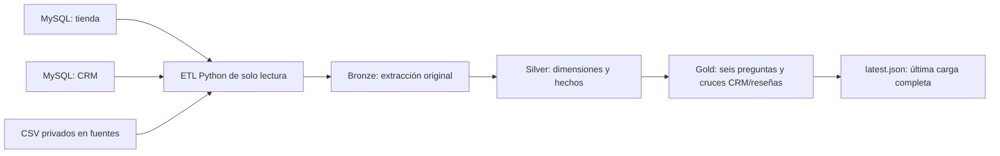

# Data Lake y ETL de Terra Nostra — CONTI

Esta etapa integra la tienda MySQL, la base CRM y CSV ficticios de reseñas. No implementa todavía Power BI/Tableau ni un modelo ML/LLM.

## Dónde está

Cuenta Azure: `stvintara508832`, grupo `rg-vintara`.

- Contenedor privado `fuentes`: `reviews/reviews_academic_v1.csv`, 180 comentarios explícitamente ficticios (`is_synthetic=1`). Las plataformas mencionadas son escenarios académicos, no comentarios extraídos de redes sociales reales.
- Contenedor privado `datalake`: capas `bronze`, `silver`, `gold`, manifiestos `runs`, errores `audit` y el puntero `latest.json`.
- Servidor: `/opt/vintara/analytics`. Archivos de ejecución y exportaciones: `analytics/private/`, excluidos de Git y del contexto Docker.
- Publicación fija para Power BI: `datalake/latest/gold/` (ocho tablas), `datalake/latest/silver/` (siete tablas) y `datalake/latest/manifest.json`. Ver [conexión y actualización](POWER_BI_LATEST.md).

En el portal: `rg-vintara` → `stvintara508832` → Almacenamiento de datos → Contenedores. El acceso a los datos requiere un rol de datos; Colaborador del grupo por sí solo no concede lectura de blobs cuando las claves compartidas están deshabilitadas. No hacer públicos los contenedores. Los archivos se pueden exportar por el acceso SSH autorizado.

## Arquitectura



El ETL usa el usuario SQL existente `vintara_etl`, con permisos SELECT en las dos bases. Las tablas se leen dentro de una transacción de solo lectura con snapshot consistente. Una lista explícita de columnas excluye contraseñas, información de tarjetas, nombres de clientes, correos, teléfonos y direcciones. Los comentarios son texto libre privado; si se incorporan comentarios reales en el futuro, deben revisarse para evitar datos personales.

Azure se autentica mediante la identidad administrada de `vm-vintara`. Tiene Storage Blob Data Contributor únicamente en `fuentes` y `datalake`, además del permiso previo en `backups`. No se usan claves de almacenamiento, SAS ni contraseñas dentro del código. Los archivos generados no se publican en la tienda ni en GitHub.

## Flujo y publicación

1. Extraer ocho conjuntos de MySQL y archivar sus JSON en `bronze/runs/<run_id>/`.
2. Leer todos los CSV UTF-8 de `fuentes/reviews/`, conservar sus bytes originales y registrar hashes y ETags.
3. Validar identificadores, moneda, cantidades, fechas, vínculos entre compras/CRM/reseñas y subtotales.
4. Construir dimensiones, hechos y agregados. Las reseñas idénticas se deduplican; las filas inválidas quedan en `quarantine.csv` y bloquean la publicación de esa ejecución.
5. Subir y descargar cada archivo para comparar SHA256. Guardar el manifiesto completo con cantidades, parámetros y resultados.
6. Actualizar `latest.json` al final con condición ETag. Si algo falla, el puntero conserva la última ejecución correcta. No combinar archivos de distintos run_id.

Desde la versión 1.1.0, antes de confirmar el puntero se preparan y verifican las 15 tablas analíticas en una carpeta temporal privada. La carpeta completa pasa a `latest` mediante renombrados de Data Lake Gen2, con un diario durable y recuperación si se interrumpe la publicación. `latest` mantiene nombres fijos y sustituye el conjunto completo: no acumula ejecuciones ni tablas retiradas. Se excluyen Bronze y cuarentena. La publicación anterior queda en `_latest_previous/<publication_id>/` como recuperación; el historial original en `*/runs/` se conserva.

El intercambio de carpetas deja un intervalo corto en que `latest` puede no estar disponible. No es una transacción de lectura de varios archivos: programar Power BI después del ETL (por ejemplo, 03:15 de Costa Rica), no durante su publicación. Si se interrumpe el proceso, la siguiente ejecución recupera el diario antes de extraer datos.

Cada carga es un snapshot completo e inmutable: repetirla no inserta ni duplica compras. Los archivos de diferentes ejecuciones se conservan para auditoría y no se deben concatenar como si fueran ventas distintas.

## Programación y demostración

Timer persistente de systemd: `terranostra-etl.timer`, todos los días a las **03:00 de Costa Rica (09:00 UTC)**. La VM debe estar encendida; `Persistent=true` ejecuta una carga pendiente cuando vuelve a arrancar. El siguiente disparo del temporizador se consulta en el servidor, no se asume a partir del reloj de la computadora.

```sh
sudo systemctl list-timers terranostra-etl.timer --all
sudo systemctl start terranostra-etl.service
sudo journalctl -u terranostra-etl.service -n 20 --no-pager
cd /opt/vintara/analytics
sudo python3 verify.py
```

`start` ejecuta el servicio manualmente bajo systemd; no prueba por sí solo que haya ocurrido un disparo programado. Durante la implementación se ejecutó además un temporizador transitorio independiente, con trigger `timer-proof`, para demostrar un disparo automático en la nube. Ver `VALIDATION.md`.

Comprobación manual y exportación para BI:

```sh
cd /opt/vintara/analytics
sudo python3 -m unittest discover -s tests -v
sudo python3 etl.py --trigger manual
sudo python3 verify.py
sudo python3 export_bi.py
```

La exportación produce `/opt/vintara/analytics/private/bi/terranostra-bi-latest.zip`. Es una copia estática privada de la carga verificada; no configura un dashboard ni su refresco automático. Para actualización de BI conectada a Azure debe configurarse posteriormente el conector, su identidad y permisos.

## Datos y limitaciones

Historial actual: mayo a noviembre de 2026; el mes en curso es parcial. Sirve para evolución mensual, no para afirmar estacionalidad anual ni causalidad del precio. Los pedidos e importes históricos son sintéticos y se conservaron durante la adaptación a vinos; no son precios históricos reales de esas botellas. Los productos tienen precios de catálogo actuales diferentes de los precios realizados en el historial académico.

No se alteran clientes, compras, inventario ni datos del CRM. El CSV de reseñas se crea una sola vez y las ejecuciones posteriores conservan las ediciones. La carga inicial usa identificadores de compras existentes; no constituye opiniones reales de esos clientes.

## Referencias técnicas

- [Identidad administrada para Azure Storage](https://learn.microsoft.com/en-us/azure/storage/common/authorize-data-access).
- [Escritura de blobs y comprobaciones de integridad](https://learn.microsoft.com/en-us/rest/api/storageservices/put-blob).
- [Publicación condicional mediante ETag](https://learn.microsoft.com/en-us/rest/api/storageservices/specifying-conditional-headers-for-blob-service-operations).
